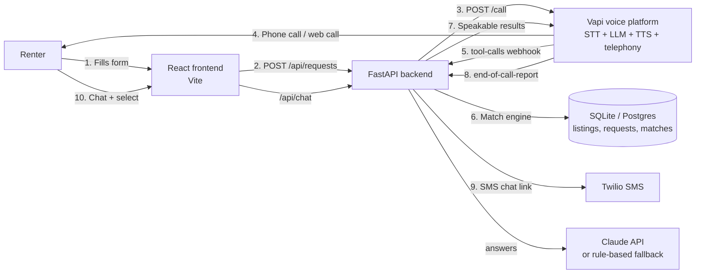
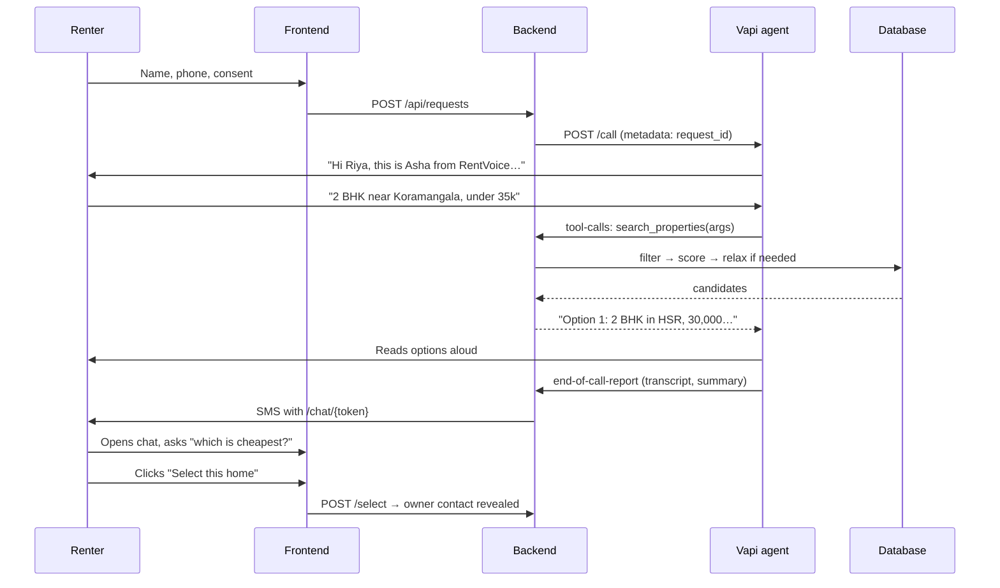

# RentVoice: AI voice assistant for finding rental homes

A renter fills a short form → an AI voice agent calls them (or talks in the browser) →
collects area, budget and size in natural conversation → searches a verified listings
database in real time → reads out the top 3 → the renter gets a chat link where they
compare homes and unlock the owner's contact.

---

## 1. Architecture



### Request lifecycle (what to draw on the whiteboard)



### Key design decisions (interviewers ask about these)

| Decision | Why |
|---|---|
| **Vapi for voice** instead of building STT/TTS myself | Telephony, barge-in, latency and turn-taking are hard problems. I own the business logic through a webhook tool; Vapi owns the audio. Swappable for Retell / LiveKit later. |
| **LLM only extracts preferences; SQL does the search** | LLMs hallucinate listings. The agent calls a typed tool (`search_properties`), so every home it mentions exists in the database. |
| **Weighted scoring + progressive relaxation** | Hard filters alone return "nothing found" too often. If fewer than 3 matches, the engine relaxes BHK by ±1, then budget by 10%, then radius to 12 km, and tells the renter what it relaxed. |
| **Listing freshness (TTL)** | Stale listings are the core problem being solved. A listing not re-confirmed by its owner in 30 days is hidden automatically. |
| **Owner contact hidden until selection** | Protects owner privacy and gives a measurable conversion event (selection rate). |
| **Web-call mode + demo simulator** | Phone calls to Indian numbers need a paid number. Browser calls are free on Vapi and make the demo reliable in any interview room. |
| **Polling for status** | Simple and enough at this scale. Upgrade path: Server-Sent Events. |
| **Rule-based chat fallback** | The demo never breaks if the LLM key is missing or rate limited. |

---

## 2. Tech stack

| Layer | Tool | Cost |
|---|---|---|
| Frontend | React 18 + Vite + React Router, plain CSS | Free |
| Backend | Python 3.11+, FastAPI, SQLAlchemy 2, Pydantic 2 | Free |
| Database | SQLite locally → Postgres (Neon / Supabase) in production | Free tier |
| Voice agent | Vapi (web SDK `@vapi-ai/web` for browser calls, REST for phone) | Free trial credits |
| Chat LLM | Claude API (optional) | Pay as you go |
| SMS | Twilio (optional) | Trial credits |
| Tunnel | ngrok (so Vapi can reach your laptop) | Free |
| Hosting | Render (API) + Vercel (frontend) + Neon (DB) | Free tiers |

---

## 3. Folder structure

```
rentvoice/
├── backend/
│   ├── app/
│   │   ├── main.py              # FastAPI app, CORS, routers
│   │   ├── config.py            # all env settings in one place
│   │   ├── database.py          # engine + session
│   │   ├── models.py            # Property, RentalRequest, Match, ChatMessage
│   │   ├── schemas.py           # request/response validation
│   │   ├── geo.py               # locality lookup + fuzzy match + haversine
│   │   ├── matching.py          # ★ filter → score → relax engine
│   │   ├── services.py          # shared logic for webhook + simulator
│   │   ├── voice.py             # Vapi system prompt, tool schemas, outbound call
│   │   ├── llm.py               # chatbot (Claude or rule-based)
│   │   ├── notify.py            # SMS chat link
│   │   └── routers/
│   │       ├── requests.py      # form submit, status, web-call, simulator
│   │       ├── vapi_webhook.py  # ★ every Vapi event lands here
│   │       ├── chat.py          # shortlist chat + select home
│   │       └── admin.py         # owner listings + verification
│   ├── scripts/
│   │   ├── seed.py              # 96 realistic Bengaluru listings
│   │   └── create_vapi_assistant.py
│   ├── tests/                   # matching + full end-to-end flow
│   ├── requirements.txt
│   └── .env.example
└── frontend/
    ├── src/
    │   ├── pages/  RequestForm · Status · Chat · Admin
    │   ├── components/  WebCall · PropertyCard · Waveform
    │   ├── api.js
    │   └── styles.css
    ├── package.json
    └── vite.config.js           # proxies /api → :8000 in dev
```

### Database schema

```
properties        id, title, city, locality, lat, lng, rent, deposit, bhk, property_type,
                  furnishing, area_sqft, amenities[json], pets_allowed, available_from,
                  owner_name, owner_phone, is_active, last_verified_at
rental_requests   id(uuid), name, phone, city, call_mode, consent, status, preferences[json],
                  relaxation_note, call_id, call_summary, transcript, chat_token,
                  selected_property_id
matches           request_id → rental_requests, property_id → properties, rank, score, reasons[json]
chat_messages     request_id, role, content
```

Request status machine: `submitted → calling → in_call → matched | no_match → completed`, with `call_failed` as the error branch.

### API

| Method | Path | Purpose |
|---|---|---|
| GET | `/api/config` | Which call modes are available (no secrets) |
| POST | `/api/requests` | Submit form; triggers outbound call in phone mode |
| GET | `/api/requests/{id}` | Status, preferences, matches (no owner contact) |
| GET | `/api/requests/{id}/call-variables` | Variables for the browser call |
| POST | `/api/requests/{id}/web-call` | Link a browser call id to the request |
| POST | `/api/requests/{id}/call` | Retry phone call |
| POST | `/api/vapi/webhook` | All Vapi events: `tool-calls`, `status-update`, `end-of-call-report` |
| GET | `/api/chat/{token}` | Shortlist + messages |
| POST | `/api/chat/{token}/messages` | Ask the chatbot |
| POST | `/api/chat/{token}/select` | Select a home → owner contact |
| POST | `/api/dev/simulate/{id}` | Demo mode: run the agent's search without a call |
| GET/POST | `/api/admin/...` | Listings CRUD, mark available, view requests (header `x-admin-token`) |

Interactive docs at **http://localhost:8000/docs** once the backend runs. Show this in interviews.

---

## 4. Build it step by step

Do the phases in order. Each one ends with something you can see working, so commit to Git after each.

### Phase 0: Set up your workstation (30 min)

Install Python 3.11+, Node.js 20+, Git, VS Code (extensions: Python, ESLint), and ngrok.

```bash
git init rentvoice && cd rentvoice
# copy the backend/ and frontend/ folders from this project in
```

Create free accounts now (approval can take a few minutes): **vapi.ai**, **ngrok.com**, and optionally **console.anthropic.com** and **twilio.com**.

### Phase 1: Backend and database (Day 1)

```bash
cd backend
python -m venv .venv
source .venv/bin/activate            # Windows: .venv\Scripts\activate
pip install -r requirements.txt
cp .env.example .env
python -m scripts.seed               # → "Seeded 96 properties"
uvicorn app.main:app --reload --port 8000
```

Open http://localhost:8000/docs and try `POST /api/requests`. Then run the tests:

```bash
pytest -q                            # 6 passed
```

**Understand before moving on:** read `models.py` then `matching.py`. Be able to explain the scoring weights and the relaxation steps without looking.

### Phase 2: Frontend (Day 1–2)

New terminal:

```bash
cd frontend
npm install
npm run dev                          # http://localhost:5173
```

Fill the form with "Talk in this browser", then on the status page open **"No microphone? Simulate the call"** and press **Run search**. You'll see the shortlist, then open the chat, ask "which is cheapest?", and select a home to reveal the owner's contact.

At this point the whole product works **without any voice**. That's deliberate: build and test the core before the expensive part.

### Phase 3: Make your laptop reachable (Day 2)

Vapi's servers must call your webhook, so expose port 8000:

```bash
ngrok http 8000
```

Copy the `https://….ngrok-free.app` URL into `backend/.env` as `PUBLIC_BACKEND_URL`. Restart uvicorn.
Test it: open `https://YOUR-URL/health` in a browser → `{"ok": true}`.

> The free ngrok URL changes each restart. When it does, update `.env` **and** the Server URL in Vapi.

### Phase 4: Create the voice agent (Day 2–3)

1. In the Vapi dashboard copy your **private key** → `VAPI_API_KEY`, and **public key** → `VAPI_PUBLIC_KEY`.
2. Invent a long random string → `VAPI_WEBHOOK_SECRET`.
3. Create the assistant:
   ```bash
   python -m scripts.create_vapi_assistant
   ```
   Paste the printed id into `VAPI_ASSISTANT_ID`. Restart uvicorn.
4. In the dashboard, open the assistant and pick a voice (an Indian English voice suits the use case), and confirm the Server URL ends in `/api/vapi/webhook`. If you set a secret, confirm it's attached to the server URL (Vapi sends it in the `X-Vapi-Secret` header or as a Bearer credential).
   - If the script is rejected because Vapi's API changed, create the assistant by hand in the dashboard: paste `SYSTEM_PROMPT` and the two tool schemas from `app/voice.py`, set each tool's server URL to your webhook, and enable the server messages `tool-calls`, `status-update` and `end-of-call-report`.
5. Restart the frontend, submit the form in **browser mode**, press **Start talking**, and say something like *"I want a 2 BHK near Koramangala, budget 35 thousand, need parking."*

Watch the uvicorn logs: you should see `Vapi event: tool-calls`, and the shortlist appears on the page.

**Debugging tips:** Vapi's dashboard has a **Call Logs** page showing every tool call and your server's response. Use it first. Most failures are (a) wrong/old ngrok URL, (b) secret mismatch → 401, (c) the agent not passing `request_id` (the webhook also falls back to call metadata and call id).

### Phase 5: Real phone calls (optional, Day 3)

Vapi's free numbers are US-only. To call Indian numbers, buy a Twilio number with international calling, import it in Vapi (**Phone Numbers → Import**), and put its id in `VAPI_PHONE_NUMBER_ID`. "Call my phone" then becomes selectable on the form. Trial accounts can only call verified numbers, so verify your own phone in Twilio.

For the SMS link after the call, fill the `TWILIO_*` variables.

### Phase 6: Smarter chat (optional, Day 3)

Add `ANTHROPIC_API_KEY` to `.env`. The chatbot switches from keyword rules to an LLM that only answers from the shortlist JSON (see the system prompt in `llm.py`; it is instructed not to invent facts or reveal contacts).

### Phase 7: Owner side (Day 4)

Go to **For owners** (`/admin`), sign in with `ADMIN_TOKEN`. You can add listings, see stale ones greyed out, and press **Mark available** to refresh them. This demonstrates the freshness mechanism.

### Phase 8: Deploy (Day 4–5)

1. **Database**: create a free Postgres on Neon. Add `psycopg2-binary` to `requirements.txt`. Set `DATABASE_URL=postgresql+psycopg2://…`.
2. **Backend on Render**: New Web Service → root `backend` → build `pip install -r requirements.txt` → start `uvicorn app.main:app --host 0.0.0.0 --port $PORT`. Add all env vars. Run the seed once from Render's shell.
3. **Frontend on Vercel**: root `frontend`, framework Vite, env `VITE_API_URL=https://your-api.onrender.com`. Add a `vercel.json` rewrite so `/requests/...` and `/chat/...` serve `index.html`:
   ```json
   { "rewrites": [{ "source": "/(.*)", "destination": "/" }] }
   ```
4. Set `FRONTEND_URL` on Render to the Vercel URL (CORS + SMS links) and `PUBLIC_BACKEND_URL` to the Render URL, then update the Server URL in Vapi.
5. Render's free tier sleeps. Open the site a minute before an interview to wake it.

---

## 5. Demo script for the interview (3 minutes)

1. **Problem (20s):** "Renters juggle many sites and slow brokers. I automated the broker's first call."
2. **Live call (90s):** Submit the form in browser mode, talk to the agent. Point out the live transcript and that the options it reads come from the database through a tool call, not the LLM's imagination.
3. **Chat (30s):** Open the chat link, ask "which allows pets?", select a home, show the owner contact unlocking.
4. **Under the hood (40s):** Open `/docs`, show the webhook endpoint, then `matching.py` scoring and relaxation. Show the admin page with stale listings hidden.

**Backup plan:** if Wi-Fi or the mic fails, use the "Simulate the call" panel. It runs the exact same code path the voice agent uses. Also record a 2-minute screen video of a real call and keep it on your laptop.

---

## 6. Resume bullets (adjust numbers to what you measure)

- Built **RentVoice**, an AI voice rental assistant (FastAPI, React, Vapi, Claude API) that phones renters, extracts preferences through natural conversation and returns verified matches in under 2 minutes.
- Designed a **tool-calling architecture** where the voice LLM only extracts structured preferences and a SQL-backed engine performs the search, eliminating hallucinated listings.
- Implemented a **weighted matching engine** (budget, haversine distance, BHK, furnishing, amenities) with progressive constraint relaxation, cutting zero-result searches.
- Added **listing freshness controls** (30-day owner re-verification TTL) and privacy-gated owner contacts revealed only on selection.
- Wrote end-to-end tests simulating Vapi webhooks; deployed on Render, Vercel and Neon Postgres.

Measure your own numbers for the bullets: run 10 test calls and record average call length, time to first match, and how often relaxation was needed.

---

## 7. Questions you should be ready for

- **Latency on the call?** The tool call is one indexed SQL query plus in-memory scoring over at most a few hundred rows (milliseconds). The bulk of latency is STT/LLM/TTS, which Vapi streams.
- **How do you stop the LLM inventing homes?** It never sees the database except through the tool result, and the prompt forbids describing anything not returned.
- **What if the caller says "Koramangla"?** `geo.py` does substring then fuzzy matching (`difflib`) against known localities. Production: a geocoding API.
- **Scaling?** Move matching to Postgres + PostGIS (`ST_DWithin`) with indexes on city, rent and bhk; put webhook work on a queue; replace polling with SSE.
- **Security?** Webhook shared secret, consent required before any call, owner phone hidden behind an unguessable chat token, admin endpoints behind a token (production: real auth with roles).
- **Legal?** Consent checkbox, call recording disclosure, and in India the TRAI/DND rules for automated calls. Calls happen only after the user requests one.
- **What would you add next?** Hindi/Kannada voice, visit scheduling with owners, WhatsApp delivery, owner availability check-ins by automated call, embeddings for soft preferences like "quiet street".

---

## 8. Stretch goals that impress

1. **Multilingual agent**: Hindi transcriber + voice, same tools.
2. **Owner verification calls**: a second Vapi assistant that calls owners weekly to confirm availability and updates `last_verified_at` through the same webhook.
3. **Map view** of matches (Leaflet + OpenStreetMap, free).
4. **Analytics page**: calls per day, match rate, selection rate, average call duration.
5. **Semantic search**: embed listing descriptions and blend similarity into the score.
